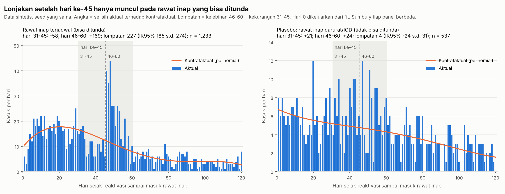
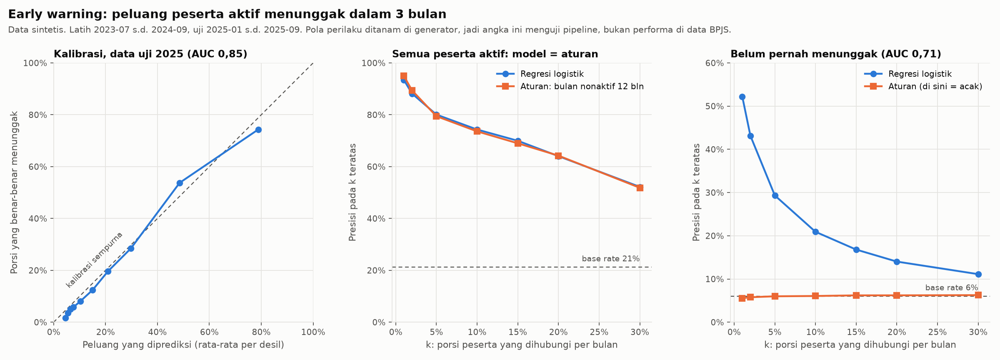

# TEPAT: Triase Peserta Tertunggak

Prototipe untuk **BPJS Kesehatan Healthkathon 2026**, kategori **Efisiensi Risiko pada Peserta**.

**Tim:**
1. Muhammad Zulkarnain
2. Zenda Oka Briantiko

> **Semua data di sini buatan kami sendiri (sintetis).** Tidak ada data peserta JKN atau data DTSEN asli.
> Angka perilaku dan biaya juga karangan kami dan belum memakai tarif INA-CBG. Angka-angka ini perlu disesuaikan bersama BPJS Kesehatan.

## Latar Belakang

Per Februari 2026, ada 63,4 juta peserta JKN yang nonaktif. Tunggakan iuran mencapai Rp26,47 triliun. Rp22,29 triliun di antaranya datang dari peserta mandiri (PBPU).

Orang menunggak karena alasan yang berbeda. Kami melihat tiga kelompok:

- **Tidak mampu.** Dulu rutin bayar, lalu berhenti karena kesulitan ekonomi.
- **Lalai.** Sebenarnya mampu, tapi sering telat bayar, lalu melunasi.
- **Bayar saat butuh.** Baru melunasi tunggakan ketika mau berobat mahal, lalu berhenti bayar lagi.

Sekarang ketiganya mendapat perlakuan yang sama.

Untuk kelompok ketiga, aturan sudah punya rem. Peserta yang dirawat inap di rumah sakit dalam 45 hari setelah aktif lagi membayar denda untuk satu kali rawat inap itu (Perpres 59/2024 Ps. 42 ayat 5–6). Celahnya: peserta bisa menunda rawat inap yang sudah terjadwal sampai lewat hari ke-45, dan dendanya hilang.

Melunasi tunggakan sebelum berobat itu sah (Ps. 42 ayat 3). Itu tidak membuktikan kecurangan. TEPAT tidak menuduh siapa pun curang. TEPAT hanya menandai pola yang perlu petugas cek.

## Cara kerja TEPAT

TEPAT tidak membuat hukuman baru. Untuk tiap peserta yang menunggak, TEPAT memilih satu jalan bantuan yang sudah ada, lalu menulis alasannya supaya petugas bisa membaca.

| Jalur | Untuk siapa | Tindakan yang sudah ada |
|---|---|---|
| `rujuk_cek_kelayakan_PBI` | Tercatat miskin di DTSEN (desil 1–5), **atau** dulu rutin bayar lalu berhenti saat DTSEN belum diperbarui | Petugas mengecek apakah peserta layak pindah ke PBI atau dibayari Pemda |
| `pengingat_autodebet_REHAB` | Sering nonaktif lalu melunasi, tanpa kaitan dengan klaim | Pengingat, autodebet, cicilan REHAB¹ |
| `verifikasi_pola_reaktivasi` | Berkali-kali aktif lagi, lalu langsung punya klaim besar | Petugas mengecek lebih dulu |
| `nonaktif_lama_tanpa_sinyal` | Menunggak 12 bulan atau lebih, tanpa kegiatan apa pun | Petugas mengecek kemampuan bayar |

¹ REHAB adalah cicilan tunggakan untuk satu keluarga. Kami tahu program ini dari berita. REHAB merupakan **praktik administrasi BPJS Kesehatan**; kami tidak menemukannya di Perpres atau Peraturan BPJS yang kami baca.

Kami hanya menghitung peserta PBPU/BP yang membayar iuran sendiri. Peserta PPU, PBI, dan PBPU/BP yang iurannya dibayar Pemda kami keluarkan, karena aturan iuran dan dendanya berbeda (Perpres 59/2024 Ps. 42 ayat 7–8).

Pegangan kami:
1. **Tanda miskin selalu menang.** Peserta DTSEN 1–5 tidak pernah masuk jalur verifikasi.
2. **Petugas yang memutuskan.** TEPAT hanya memberi urutan dan alasan.
3. **Skor tidak boleh membuat peserta kehilangan jaminan.**

TEPAT juga menjalankan **uji lonjakan hari ke-45** (*bunching*). Uji ini melihat apakah rawat inap terjadwal menumpuk tepat setelah hari ke-45. Kalau menumpuk, itu tanda ada yang menunda supaya lolos dari denda. Hasilnya menjadi bahan untuk pembuat kebijakan.

Untuk peserta yang masih aktif, ada **peringatan dini** (`early_warning.py`). Model regresi logistik menebak peluang seorang peserta mulai menunggak dalam 3 bulan ke depan. Kami menghitung skornya tiap tanggal 1, sebelum batas bayar tanggal 10. Skor ini hanya memicu bantuan: pengingat, tawaran autodebet, atau cek kelayakan PBI. Skor ini tidak pernah memasukkan orang ke jalur verifikasi.

## Cara menjalankan

Siapkan Python 3.10 atau lebih baru.

```bash
python -m venv .venv
.venv/Scripts/activate            # Windows. Linux/macOS: source .venv/bin/activate
pip install -r requirements.txt
python generate_data.py --n 20000 --seed 2026 --out data   # ±20 detik
python cek_sinyal.py --data data --out hasil                # ±5 detik
python early_warning.py --data data --out hasil             # ±15 detik
python uji_stabilitas.py --seeds 2026 1 2 3 4 --out hasil   # ±3 menit, membuat data sendiri
python daya_uji_bunching.py --data data --out hasil         # ±1 menit
```

`--n` adalah jumlah peserta PBPU/BP mandiri. Generator juga membuat peserta PPU, PBI, dan PBPU/BP-Pemda sebanyak 15% dari `--n` (ubah lewat `--n_lain`). Analisis lalu membuang peserta kelompok lain itu.

Folder `data/` tidak ikut di-commit karena besarnya sekitar 50 MB. Buat ulang dengan perintah di atas. Seed (angka awal pengacak) yang sama menghasilkan data yang sama persis. Untuk sekadar melihat bentuk tabelnya, buka `data_sampel/` (500 peserta mandiri + 75 peserta kelompok lain).

### Cek angka tidak berubah

Sebelum commit yang mengubah skrip atau `requirements.txt`, jalankan ulang ke folder `hasil_cek/` (jangan ke `hasil/`), lalu cocokkan:

```bash
python generate_data.py --n 20000 --seed 2026 --out data
python cek_sinyal.py --data data --out hasil_cek
python early_warning.py --data data --out hasil_cek
python cocokkan_angka.py --data data --hasil hasil_cek
```

`cocokkan_angka.py` mengecek 58 hal: jumlah baris dan total rupiah data, angka-angka di proposal (jalur triase, presisi dan recall, uji lonjakan, plasebo IGD, peringatan dini, daftar Desember 2025), aturan DTSEN 1–5, dan kesamaan isi `hasil_cek/` dengan `hasil/`. Kalau ada yang beda, skrip berhenti dengan kode 1. Pakai scikit-learn 1.4 ke atas: versi 1.3 tetap jalan, tapi angka peringatan dininya bergeser.

### Data untuk aplikasi

Aplikasi tidak menghitung apa-apa saat dibuka. Kami menghitung semua hasil sekali, lalu menyimpannya di `app_data/` (ikut di-commit, sekitar 3,6 MB, batas 20 MB):

```bash
python siapkan_app.py --data data --out app_data   # ±20 detik
```

| File | Isi |
|---|---|
| `daftar_kerja.parquet` | jalur dan alasan untuk tiap peserta dari 20.000 peserta mandiri, per 31 Des 2025 |
| `ew_daftar.parquet` | peringatan dini Desember 2025: 14.237 peserta aktif, urut dari yang paling berisiko. Kolom `masuk_daftar` menandai 712 teratas (5%). Ada juga besar sumbangan tiap faktor ke skor |
| `linimasa_bayar` / `_status` / `_klaim` / `_reaktivasi` `.parquet` | riwayat bayar, status, klaim, dan aktif-lagi tiap peserta, untuk halaman profil |
| `bunching_harian.parquet`, `bunching_ringkasan.parquet` | uji lonjakan hari ke-45 dan plasebo IGD |
| `peserta.parquet` | ciri peserta (kelas, usia, jenis kelamin, wilayah, autodebet), tingkat kemiskinan wilayah, desil DTSEN |
| `evaluasi_label.parquet` | kunci jawaban data buatan, **hanya** untuk halaman Evaluasi |
| `manifest.json` | jumlah baris, kolom, ukuran, versi paket, dan hasil pengecekan |

Skrip menolak menyimpan kalau angka utama beda dari angka di proposal, ada peserta DTSEN 1–5 di jalur verifikasi, kolom kunci jawaban muncul di luar `evaluasi_label.parquet`, atau ukurannya lebih dari 20 MB. Buat ulang `app_data/` setiap kali skrip berubah.

Catatan kecil: di versi paket Python yang berbeda, peserta dengan skor peringatan dini yang persis sama bisa bertukar urutan (selisih skornya sekitar 1e-13). Daftar 712 dan angka di proposal tetap sama.

### Menjalankan aplikasi

```bash
streamlit run app.py
```

Dua halaman: **Daftar kerja** (triase pola bayar dan peringatan dini, filter wilayah, rute, kapasitas k) dan **Profil peserta** (linimasa 3 tahun, rute dan alasan, keputusan petugas, draf pesan). Profil bisa dibuka langsung lewat alamat `/profil?id=P-002329`.

- Aplikasi hanya membaca `app_data/`. `evaluasi_label.parquet` tidak dibaca di kedua halaman ini.
- Sorotan "klaim besar ≤ 90 hari setelah aktif kembali" di linimasa memakai konstanta yang sama dengan `cek_sinyal.py`, dan cocok dengan `n_reakt_terkait_klaim` per peserta.
- Keputusan petugas tersimpan selama sesi dan tidak mengubah rute. Draf pesan berasal dari template (`pesan_template.py`), yang nanti menjadi jalur cadangan lapisan AI.
- Tema dan font ada di `.streamlit/config.toml`. Huruf memakai Plus Jakarta Sans dan angka memakai IBM Plex Mono, keduanya berlisensi OFL dan disimpan di `static/fonts/`.

## Isi folder

```
generate_data.py      membuat 7 tabel data buatan (Jan 2023 – Des 2025)
cek_sinyal.py         uji lonjakan, ciri perilaku, triase, cek ke kunci jawaban
early_warning.py      model peringatan dini dan daftar peserta berisiko
uji_stabilitas.py     menjalankan semuanya di 5 seed dan mencatat rentang tiap angka
daya_uji_bunching.py  simulasi: berapa banyak penundaan yang bisa ditangkap uji lonjakan
cocokkan_angka.py     cek angka proposal tidak berubah
siapkan_app.py        menghitung sekali semua data untuk aplikasi -> app_data/
app.py                aplikasi Streamlit (halaman ada di halaman/, bagian bersama di tepat_ui.py)
pesan_template.py     draf pesan per rute, tanpa AI
app_data/             data siap baca untuk aplikasi (ikut di-commit)
data_sampel/          contoh kecil: 500 peserta mandiri + 75 kelompok lain (seed 2026)
hasil/                ringkasan, grafik, dan tabel hasil
```

## Aturan JKN yang kami tiru (versi sederhana) dan dasar hukumnya

| Aturan di generator | Dasar | Status |
|---|---|---|
| Kami hanya menganalisis peserta PBPU/BP yang membayar iuran sendiri. Generator tetap membuat peserta PPU, PBI, dan PBPU/BP-Pemda, lalu kami keluarkan | Perpres 59/2024 Ps. 42 ayat (7)–(8) | Berlaku |
| Iuran per orang per bulan: peserta membayar Rp150.000 untuk K1 dan Rp100.000 untuk K2. Iuran K3 Rp42.000 terdiri dari Rp35.000 dari peserta dan Rp7.000 bantuan pemerintah | Perpres 64/2020 Ps. 34 ayat (1) huruf b | Berlaku. Prototipe menagih Rp42.000 penuh untuk K3 |
| Bantuan iuran K3 hanya untuk peserta aktif. Untuk bulan yang tertunggak, bagian yang ditagih belum jelas | Perpres 64/2020 Ps. 34 ayat (4) | **Terbuka** |
| Peserta baru membayar iuran pertama paling cepat 14 hari setelah daftar, dan aktif sejak bayar | Belum diverifikasi | **Terbuka** |
| Kalau iuran belum dibayar sampai akhir bulan, jaminan **Peserta** berhenti sementara mulai tanggal 1 bulan berikutnya | Perpres 59/2024 Ps. 42 ayat (1) | Berlaku, per peserta |
| Peserta aktif lagi setelah melunasi tunggakan (paling banyak 24 bulan) dan iuran bulan berjalan | Perpres 59/2024 Ps. 42 ayat (3); Peraturan BPJS 5/2018 Ps. 26 ayat (2) | Berlaku |
| Denda untuk **satu kali** rawat inap tingkat lanjutan dalam 45 hari setelah aktif lagi: 5% × perkiraan biaya paket INA-CBG × bulan tertunggak (paling banyak 12), paling tinggi **Rp20 juta** | Perpres 59/2024 Ps. 42 ayat (5)–(6); Peraturan BPJS 2/2024 Ps. 24 ayat (8) | Berlaku. Prototipe memakai biaya klaim buatan, belum memakai paket INA-CBG |
| Pemberi kerja menanggung denda PPU. Aturan iuran dan denda ini tidak berlaku untuk PBI dan PBPU/BP-Pemda | Perpres 59/2024 Ps. 42 ayat (7)–(8) | Berlaku |
| Peserta PBPU/BP membayar lewat nomor VA yang mereka terima saat mendaftar. Pembayarannya sekaligus untuk total tagihan semua anggota keluarga di KK | Peraturan BPJS 5/2018 Ps. 12 ayat (3)–(4); Ps. 14 ayat (3)–(4) | Berlaku. **Belum kami tiru**, karena generator masih menghitung per peserta |

Kami tidak memakai denda 2,5% dan batas Rp30 juta. Batas Rp30 juta datang dari Perpres 64/2020 Ps. 42 ayat (6), yang sudah diubah. Angka 2,5% hanya berlaku untuk masa peralihan 2020 (ayat 6a).

## Tabel data

| Tabel | Kolom utama |
|---|---|
| `peserta` | id_peserta (nama samaran), tgl_daftar, kelas, iuran_bulanan (kosong untuk PPU), usia_2023, jenis_kelamin, kode_wilayah, autodebet, segmen_kepesertaan (`PBPU` / `BP` / `PPU` / `PBI` / `PBPU_BP_Pemda`), pembayar_iuran |
| `pembayaran` | tgl_bayar, periode_awal, periode_akhir, jumlah_bulan_dibayar, nominal (kosong untuk pembayaran pemberi kerja), kanal |
| `riwayat_status` | tgl_mulai, tgl_selesai, status (`aktif` / `nonaktif` / `masa_tunggu`) |
| `klaim` | id_episode, tgl_masuk, tgl_keluar, jenis_layanan (RJTL/RITL), cara_masuk, kelompok_layanan, biaya_klaim, denda_pelayanan |
| `dtsen_flag` | rentang_desil (`1-5` / `6-10`), tgl_pemutakhiran. Kami sengaja membuatnya terlambat diperbarui |
| `wilayah` | kode_wilayah, indeks_kemiskinan (40 wilayah karangan) |
| `label_ground_truth` | segmen (`di_luar_cakupan` untuk PPU, PBI, PBPU/BP-Pemda), pengakal_45, peserta_baru, tgl_guncangan. **Hanya untuk mengukur hasil** |

## Hasil di data buatan (seed 2026)

> Angka di bawah hanya menunjukkan bahwa kode kami bekerja. Kami menanam pola di data buatan, lalu mencoba menemukannya lagi. Angka ini belum mengukur hasil di data BPJS yang asli.

- **Cakupan:** Kami menganalisis 20.000 peserta PBPU/BP mandiri dan mengeluarkan 3.000 peserta PPU, PBI, dan PBPU/BP-Pemda. Di antara yang dikeluarkan ada 159 kasus aktif-lagi peserta PPU. Kasus itu terjadi karena pemberi kerja telat bayar, jadi tidak menggambarkan kebiasaan bayar pesertanya.
- **Uji lonjakan:** Ada 169 rawat inap terjadwal "kelebihan" di hari 46–60 (rentang ketidakpastian 95%, atau IK95%: 131–213). "Kelebihan" artinya lebih banyak dari perkiraan kami kalau tidak ada yang menunda. Kami memperkirakan denda yang lolos Rp745 juta. Hitungannya: satu rawat inap per kali aktif lagi, denda paling tinggi Rp20 juta, dan biaya klaim buatan. Ada juga 62 kasus yang melunasi tunggakan tepat di hari masuk rumah sakit.
- **Pembanding IGD (plasebo):** Rawat inap darurat lewat IGD tidak bisa ditunda, jadi seharusnya tidak melonjak. Kami memakai ukuran **lompatan**: kelebihan di hari 46–60 ditambah kekurangan di hari 31–45. Orang yang menunda memindahkan kasus dari sebelum hari ke-45 ke sesudahnya, jadi kedua sisi ikut berubah.
  - Rawat inap terjadwal: lompatan 227 (IK95% 185–274).
  - IGD: lompatan 4 (IK95% −24 s.d. 31). Rentang ini mencakup nol.

  Melihat kelebihan hari 46–60 saja tidak cukup. Di IGD, hari 46–60 juga kelebihan 24 kasus, tapi hari 31–45 ikut kelebihan 21 kasus. Artinya garis perkiraan kami yang terlalu rendah, dan tidak ada yang menunda.
- **Triase.** TEPAT tidak melihat kunci jawaban. Kami memakai kunci jawaban hanya untuk mengukur hasil. **Presisi**: dari peserta yang masuk sebuah jalur, berapa persen yang memang termasuk kelompok sasarannya. **Recall**: dari semua anggota kelompok sasaran, berapa persen yang masuk jalur itu.

| Jalur | Kelompok sasaran | Presisi | Recall |
|---|---|---|---|
| `verifikasi_pola_reaktivasi` | bayar saat butuh | 98,0% | 44,3% |
| `rujuk_cek_kelayakan_PBI` | tidak mampu | 86,3% | 70,5% |
| `pengingat_autodebet_REHAB` | lalai | 86,8% | 88,7% |

- TEPAT menangkap 603 peserta tidak mampu dari pola bayarnya, padahal DTSEN mereka belum mencatat desil 1–5.
- 18 peserta tidak mampu salah masuk jalur verifikasi. Kesalahan ini yang paling ingin kami kurangi.



- **Stabilitas di 5 seed** (2026, 1, 2, 3, 4; aturan sama; `hasil/stabilitas_ringkasan.csv`). Kami membuat 5 dunia buatan dengan aturan yang sama, lalu mencatat rentang tiap angka:

| Angka | Terkecil–terbesar |
|---|---|
| Uji lonjakan terjadwal: kelebihan hari 46–60 | 152–242 kasus |
| Uji lonjakan terjadwal: lompatan (IK95% di atas 0 di 5 dari 5 seed) | 192–268 |
| Plasebo IGD: lompatan (IK95% mencakup 0 di 4 dari 5 seed) | −8 s.d. 28 |
| Denda yang lolos (biaya buatan) | Rp592–989 juta |
| Jalur verifikasi: presisi / recall | 98,0–98,6% / 43,0–46,7% |
| Jalur cek PBI: presisi / recall | 84,9–86,9% / 70,5–72,9% |
| Jalur pengingat/REHAB: presisi / recall | 86,7–88,0% / 88,1–89,2% |
| Peserta tidak mampu di jalur verifikasi | 13–18 orang |
| Peringatan dini: AUC | 0,849–0,854 |

- **Daya uji lonjakan** (`hasil/daya_uji_mde.csv`). Data kami punya 1.233 rawat inap terjadwal dalam 1–120 hari setelah aktif lagi. Dengan jumlah itu, uji ini menangkap penundaan 8 dari 10 kali (daya 80%) kalau sedikitnya 54 kasus (4,4%) bergeser melewati hari ke-45. Dengan 10.000 kasus, cukup 1,6%. Kalau penundaannya menyebar (46 + Exp(15) hari), butuh 87 kasus (7,0%). Kami menghitung ambang ini dari kurva yang mulus, jadi kebutuhan sebenarnya bisa lebih besar.

Di seed 3, lompatan IGD 28 (IK95% 1–57), sedikit di atas nol. Jadi dengan data sebesar ini, uji bisa memberi sinyal palsu sampai sekitar 30 kasus, dan kami tidak mengklaim efek di bawah itu. Kelima seed memakai asumsi yang sama. Kalau asumsinya salah, kelimanya ikut salah.

- **Peringatan dini.** Model belajar dari titik tebakan 2023-07 s.d. 2024-09, lalu kami uji di 2025-01 s.d. 2025-09. Model hanya memakai data sebelum tanggal tebakan; kami mengeceknya dengan memotong data di 2024-06. **AUC** mengukur seberapa baik model mengurutkan peserta dari yang paling berisiko: 0,5 sama dengan menebak acak, 1 berarti sempurna.

| Ukuran (data uji) | Seed 2026 | Rentang seed 2026, 1, 2 |
|---|---|---|
| AUC, semua peserta aktif | 0,854 | 0,854–0,854 |
| AUC aturan sederhana "bulan nonaktif dalam 12 bulan" | 0,822 | 0,817–0,822 |
| Presisi 5% teratas, model / aturan | 80,1% / 79,4% | model 79,4–80,1% |
| AUC, peserta yang belum pernah nonaktif | 0,708 | 0,704–0,721 |
| Presisi 1% teratas di kelompok itu (yang menunggak 6%) | 52,2% | 52,2–55,7% |

Untuk semua peserta, model **tidak lebih baik** dari aturan sederhana kalau petugas hanya sanggup menghubungi sedikit orang. Huruf k berarti persen peserta yang bisa petugas hubungi tiap bulan. Di k ≤ 2%, aturan malah sedikit lebih tepat di ketiga seed (k 1%: aturan 93,6–95,0%, model 90,6–93,4%). Sebagai gambaran, k 1% sama dengan sekitar 175 ribu orang per bulan untuk 17,46 juta peserta PBPU Mandiri aktif (30 Sep 2025). Angka kapasitas petugas yang resmi belum ada, jadi kami melaporkan presisi untuk k 0,5–20% (`hasil/early_warning_presisi_k.csv`).

Model berguna untuk peserta yang belum pernah menunggak. Di kelompok itu, aturan sederhana sama saja dengan menebak acak. Model juga menganggap risiko peserta tidak mampu lebih kecil dari kenyataan (tebakan 38%, kenyataan 66%), karena generator kami tidak membuat tanda-tanda sebelum orang jatuh miskin. Kami tidak memakai DTSEN di model: datanya cuma satu potret per 2025-01-01, dan isinya ikut dipengaruhi kejadian sesudahnya.



## Keterbatasan

1. **Berputar di data sendiri.** Kami menanam pola di data buatan, lalu menemukannya lagi. Pembuktian sebenarnya butuh data BPJS.
2. **Masih per orang.** Tagihan PBPU/BP dihitung bersama untuk satu KK (Peraturan BPJS 5/2018 Ps. 12 ayat 4; Ps. 14 ayat 4), sedangkan penghentian jaminan dan denda berlaku per peserta (Perpres 59/2024 Ps. 42 ayat 1 dan 5). Generator kami baru menghitung per peserta. Kami akan menambahkan tagihan per KK sebagai lapisan terpisah, dan kami tidak menganggap satu KK sama dengan satu nomor VA.
3. **Uji lonjakan masih sederhana** (garis polinomial, rentang hari tetap). Garis polinomial bisa terlalu rendah di hari-hari yang kami kecualikan. Contohnya plasebo IGD: kelebihan sampai 24 kasus di hari 46–60, padahal tidak ada yang menunda. Karena itu kami memakai lompatan. Untuk data asli, pakai metode dengan batasan integrasi, yang menjaga jumlah kasus yang hilang sama dengan jumlah kasus yang muncul (Chetty dkk. 2011; Kleven 2016).
4. **Data DTSEN** kami anggap bisa didapat lewat kerja sama data resmi antarlembaga.
5. **Recall jalur verifikasi rendah.** Sebagian peserta belum perlu berobat selama masa pengamatan, jadi polanya belum terlihat.
6. **Belum mengukur dampak tindakan.** Langkah berikutnya: uji coba terkontrol per jalur. Peringatan dini menebak siapa yang *akan* menunggak. Model ini belum tahu siapa yang *bisa dicegah* menunggak lewat pengingat. Untuk itu kami butuh data uji coba.
7. **Peringatan dini belum punya tanda awal orang jatuh miskin.** Generator belum membuat autodebet gagal, turun kelas, atau bayar yang makin mepet tanggal 10. Di generator, orang yang rutin bayar selalu bayar tanggal 1–10.

## Pertanyaan yang belum terjawab (akan kami cek ke data BPJS Kesehatan)

1. **Nomor VA diberikan per peserta atau per KK, dan apakah nomornya tetap?** Peraturan BPJS 5/2018 Ps. 12 ayat (3) hanya menyebut "nomor Virtual Account", tanpa jumlah. Ps. 26 ayat (1) huruf a dan Ps. 28 ayat (2) huruf a memakai kata "VA Peserta". Peraturan BPJS 6/2018 Ps. 23 ayat (2) memakai kata "VA keluarga". Karena itu kami tidak menganggap satu KK pasti punya satu VA.
2. **Apakah anggota KK baru aktif lagi setelah seluruh tunggakan satu KK lunas?** Ps. 42 ayat (1) mengatur penghentian per Peserta. Kami belum menemukan teks aturan untuk tingkat KK. Kami juga tidak menyimpulkan bahwa kalau satu anggota berhenti, seluruh KK ikut berhenti.
3. **Berapa bagian iuran K3 yang ditagih untuk bulan yang tertunggak?** Terkait Perpres 64/2020 Ps. 34 ayat (4).
4. **Apa dasar hukum masa tunggu 14 hari untuk peserta baru?**
5. **Apakah sudah ada penetapan iuran setelah 1 Juli 2025?** Perpres 59/2024 Ps. 103B ayat (8) mewajibkannya, tapi kami belum menemukan aturannya.

## Dasar hukum dan sumber angka

- Peraturan Presiden 82/2018 tentang Jaminan Kesehatan, berlaku: [JDIH BPK](https://peraturan.bpk.go.id/Details/94711)
- Peraturan Presiden 64/2020, perubahan kedua (Ps. 34): [PDF JDIH BPK](https://peraturan.bpk.go.id/Download/127554/Perpres%20Nomor%2064%20Tahun%202020.pdf)
- Peraturan Presiden 59/2024, perubahan ketiga (Ps. 42): [PDF JDIH BPK](https://peraturan.bpk.go.id/Download/344279/Perpres%20Nomor%2059%20Tahun%202024.pdf)
- Peraturan BPJS Kesehatan 5/2018 (BN 2018 No. 1665), Ps. 12, 14, 26, dan 28
- Peraturan BPJS Kesehatan 6/2018, Ps. 23 ayat (2); Peraturan BPJS Kesehatan 2/2024, Ps. 24 ayat (8)
- Angka tunggakan dan peserta nonaktif: [Bisnis.com, 11 Februari 2026](https://finansial.bisnis.com/read/20260211/215/1952107/menkes-ungkap-tunggakan-iuran-bpjs-kesehatan-capai-rp2647-triliun)

## Lisensi

MIT, lihat [LICENSE](LICENSE).
