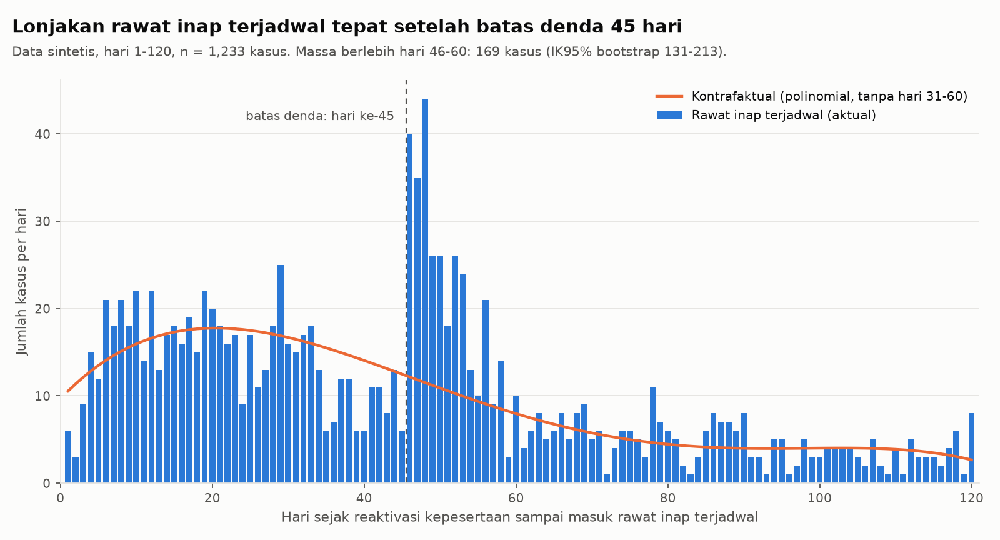

# TEPAT: Triase Peserta Tertunggak

Prototipe untuk **BPJS Kesehatan Healthkathon 2026**, kategori **Efisiensi Risiko pada Peserta**.

**Tim:**
1. Muhammad Zulkarnain
2. Zenda Oka Briantiko

> **Semua data di repositori ini sintetis.** Tidak ada data peserta JKN atau data DTSEN asli.
> Parameter perilaku dan biaya **ilustratif** (bukan tarif INA-CBG) dan wajib dikalibrasi bersama BPJS Kesehatan.

## Masalah

Per Februari 2026, 63,4 juta peserta JKN nonaktif. Tunggakan iuran mencapai Rp26,47 triliun, dan Rp22,29 triliun di antaranya berasal dari peserta mandiri (PBPU). Orang-orang ini punya alasan menunggak yang berbeda, tapi saat ini semuanya mendapat perlakuan yang sama:

- **tidak mampu**: rutin membayar sampai terkena guncangan ekonomi;
- **lalai**: mampu, tapi sering bolong lalu melunasi;
- **reaktivasi saat butuh**: melunasi hanya ketika akan memakai layanan mahal, lalu berhenti lagi.

Untuk pola ketiga sudah ada rem: denda pelayanan untuk **satu kali rawat inap tingkat lanjutan** dalam 45 hari sejak kepesertaan aktif kembali (Perpres 59/2024 Ps. 42 ayat 5–6). Tapi batas 45 hari bisa diakali dengan **menunda rawat inap terjadwal** sampai lewat hari ke-45.

Mengaktifkan kembali kepesertaan menjelang klaim itu sah (Ps. 42 ayat 3) dan bukan bukti kecurangan. TEPAT tidak menetapkan fraud. Sistem ini menandai pola reaktivasi dan rawat inap tingkat lanjutan yang perlu diverifikasi petugas.

## Pendekatan

TEPAT **tidak membuat sanksi baru**. Tiap peserta yang menunggak diarahkan ke intervensi yang sudah ada, lengkap dengan alasan yang bisa dibaca petugas:

| Rute | Untuk siapa | Intervensi yang sudah ada |
|---|---|---|
| `rujuk_cek_kelayakan_PBI` | Flag DTSEN desil 1–5, **atau** pola "rutin lalu berhenti" saat DTSEN belum diperbarui | Verifikasi pengalihan ke PBI / PBPU Pemda |
| `pengingat_autodebet_REHAB` | Sering nonaktif lalu melunasi, tidak terkait klaim | Pengingat, autodebet, cicilan REHAB¹ |
| `verifikasi_pola_reaktivasi` | Reaktivasi berulang yang diikuti klaim besar | Prioritas verifikasi petugas |
| `nonaktif_lama_tanpa_sinyal` | Menunggak ≥12 bulan tanpa aktivitas | Verifikasi kemampuan bayar |

¹ REHAB (cicilan tunggakan yang dihitung untuk satu keluarga) adalah **praktik administrasi BPJS Kesehatan** yang diberitakan media. Program ini bukan norma dalam Perpres atau Peraturan BPJS yang kami baca.

Cakupan analisis hanya peserta PBPU/BP yang membayar iuran sendiri. Peserta PPU, PBI, dan PBPU/BP yang iurannya dibayar Pemda dikeluarkan, karena iuran dan dendanya diatur berbeda (Perpres 59/2024 Ps. 42 ayat 7–8).

Prinsip yang dipakai:
1. **Indikasi miskin selalu menang.** Peserta dengan flag DTSEN 1–5 tidak pernah masuk rute verifikasi.
2. **Manusia yang memutuskan.** Keluaran sistem adalah prioritas dan alasan, bukan vonis.
3. **Tidak ada peserta yang kehilangan manfaat** karena skor.

Selain triase per peserta, ada **uji bunching** di hari ke-45 setelah reaktivasi. Uji ini menjadi bukti kebijakan apakah batas denda sedang diakali.

## Menjalankan

```bash
pip install -r requirements.txt
python generate_data.py --n 20000 --seed 2026 --out data   # ±20 detik
python cek_sinyal.py --data data --out hasil                # ±5 detik
```

`--n` adalah jumlah peserta PBPU/BP mandiri. Generator juga membuat peserta PPU, PBI, dan PBPU/BP-Pemda sebanyak 15% dari `--n` (atur dengan `--n_lain`). Peserta segmen lain ini dikeluarkan saat analisis.

Folder `data/` tidak di-commit karena ukurannya sekitar 50 MB. Buat ulang dengan perintah di atas: seed yang sama menghasilkan data yang identik. Untuk sekadar melihat struktur tabel, buka `data_sampel/` (500 peserta mandiri + 75 peserta segmen lain).

## Struktur

```
generate_data.py   generator 7 tabel sintetis (Jan 2023 – Des 2025)
cek_sinyal.py      uji bunching, fitur perilaku, triase, validasi ke label
data_sampel/       contoh 500 peserta mandiri + 75 segmen lain (seed 2026)
hasil/             ringkasan.txt, bunching_hari45.png
```

## Aturan JKN yang dimodelkan (disederhanakan) dan dasar hukumnya

| Aturan di generator | Dasar | Status |
|---|---|---|
| Analisis hanya mencakup PBPU/BP yang membayar iuran sendiri. PPU, PBI, dan PBPU/BP-Pemda dibuat terpisah lalu dikeluarkan | Perpres 59/2024 Ps. 42 ayat (7)–(8) | Berlaku |
| Iuran per orang per bulan: K1 Rp150.000 dan K2 Rp100.000 dibayar peserta. K3 Rp42.000 = Rp35.000 dibayar peserta + Rp7.000 bantuan pemerintah | Perpres 64/2020 Ps. 34 ayat (1) huruf b | Berlaku. Prototipe menagih Rp42.000 penuh untuk K3 |
| Bantuan iuran K3 hanya untuk peserta aktif, jadi porsi yang ditagih untuk bulan tertunggak belum jelas | Perpres 64/2020 Ps. 34 ayat (4) | **Terbuka** |
| Peserta baru membayar iuran pertama ≥14 hari setelah daftar, aktif sejak bayar | Belum diverifikasi | **Terbuka** |
| Iuran belum dibayar sampai akhir bulan: penjaminan **Peserta** dihentikan sementara mulai tanggal 1 bulan berikutnya | Perpres 59/2024 Ps. 42 ayat (1) | Berlaku, per peserta |
| Aktif kembali setelah tunggakan (paling banyak 24 bulan) dan iuran bulan berjalan dibayar | Perpres 59/2024 Ps. 42 ayat (3); Peraturan BPJS 5/2018 Ps. 26 ayat (2) | Berlaku |
| Denda untuk **satu kali** rawat inap tingkat lanjutan dalam 45 hari sejak aktif kembali: 5% × perkiraan biaya paket INA-CBG × bulan tertunggak (paling banyak 12), paling tinggi **Rp20 juta** | Perpres 59/2024 Ps. 42 ayat (5)–(6); Peraturan BPJS 2/2024 Ps. 24 ayat (8) | Berlaku. Prototipe memakai biaya klaim sintetis, bukan paket INA-CBG |
| Denda PPU ditanggung pemberi kerja. PBI dan PBPU/BP-Pemda dikecualikan dari ketentuan iuran dan denda | Perpres 59/2024 Ps. 42 ayat (7)–(8) | Berlaku |
| Iuran PBPU/BP dibayar lewat nomor VA yang diberikan saat pendaftaran, secara kolektif atas total tagihan seluruh anggota keluarga sesuai KK | Peraturan BPJS 5/2018 Ps. 12 ayat (3)–(4); Ps. 14 ayat (3)–(4) | Berlaku. **Belum dimodelkan**, karena generator masih per peserta |

Denda 2,5% dan batas Rp30 juta tidak kami pakai sebagai aturan berlaku. Batas Rp30 juta berasal dari Perpres 64/2020 Ps. 42 ayat (6) yang sudah diubah. Angka 2,5% hanya berlaku untuk skema transisi 2020 (ayat 6a).

## Tabel

| Tabel | Kolom utama |
|---|---|
| `peserta` | id_peserta (pseudonim), tgl_daftar, kelas, iuran_bulanan (kosong untuk PPU), usia_2023, jenis_kelamin, kode_wilayah, autodebet, segmen_kepesertaan (`PBPU` / `BP` / `PPU` / `PBI` / `PBPU_BP_Pemda`), pembayar_iuran |
| `pembayaran` | tgl_bayar, periode_awal, periode_akhir, jumlah_bulan_dibayar, nominal (kosong untuk pembayaran pemberi kerja), kanal |
| `riwayat_status` | tgl_mulai, tgl_selesai, status (`aktif` / `nonaktif` / `masa_tunggu`) |
| `klaim` | id_episode, tgl_masuk, tgl_keluar, jenis_layanan (RJTL/RITL), cara_masuk, kelompok_layanan, biaya_klaim, denda_pelayanan |
| `dtsen_flag` | rentang_desil (`1-5` / `6-10`), tgl_pemutakhiran. Sengaja dibuat punya jeda pembaruan |
| `wilayah` | kode_wilayah, indeks_kemiskinan (40 wilayah fiktif) |
| `label_ground_truth` | segmen (`di_luar_cakupan` untuk PPU, PBI, PBPU/BP-Pemda), pengakal_45, peserta_baru, tgl_guncangan. **Hanya untuk evaluasi** |

## Hasil pada data sintetis (seed 2026)

> Angka berikut **membuktikan bahwa metode dan pipeline berjalan**, bukan performa di data nyata. Pola ditanam di generator lalu dideteksi kembali.

- **Cakupan:** 20.000 peserta PBPU/BP mandiri dianalisis. Sebanyak 3.000 peserta PPU, PBI, dan PBPU/BP-Pemda dikeluarkan, termasuk 159 reaktivasi PPU yang terjadi karena pemberi kerja menunggak, bukan karena pola bayar peserta.
- **Bunching:** 169 kasus rawat inap terjadwal berlebih di hari 46–60 (IK95% bootstrap 131–213). Estimasi denda yang terhindar Rp745 juta, dihitung untuk satu kali rawat inap per reaktivasi dengan batas Rp20 juta dan biaya klaim sintetis. Ada 62 kasus yang melunasi tunggakan tepat di hari masuk RS.
- **Triase** (tanpa label; label hanya dipakai untuk mengukur):

| Rute | Presisi | Recall |
|---|---|---|
| `verifikasi_pola_reaktivasi` | 98,0% | 44,3% |
| `rujuk_cek_kelayakan_PBI` | 86,3% | 70,5% |
| `pengingat_autodebet_REHAB` | 86,8% | 88,7% |

- 603 peserta tidak mampu tertangkap lewat pola bayar padahal flag DTSEN mereka belum 1–5.
- 18 peserta tidak mampu masuk rute verifikasi. Ini kesalahan yang paling ingin kami tekan.



## Keterbatasan

1. **Sirkular**: pola sengaja ditanam di data sintetis. Validasi sesungguhnya butuh data BPJS.
2. **Unit perorangan**: tagihan PBPU/BP dihitung kolektif per KK (Peraturan BPJS 5/2018 Ps. 12 ayat 4; Ps. 14 ayat 4), sedangkan penghentian sementara dan denda berlaku per peserta (Perpres 59/2024 Ps. 42 ayat 1 dan 5). Generator baru memodelkan level peserta. Level tagihan KK akan ditambahkan sebagai lapisan terpisah, dan kami tidak menganggap satu KK sama dengan satu VA.
3. **Estimator bunching sederhana** (polinomial, jendela tetap). Untuk data nyata, pakai estimator dengan batasan integrasi (Chetty dkk. 2011; Kleven 2016).
4. **Flag DTSEN** diasumsikan tersedia lewat integrasi data antarlembaga resmi.
5. **Recall rute verifikasi rendah**: sebagian peserta belum butuh layanan selama jendela observasi (tersensor).
6. **Belum mengukur efek intervensi.** Langkah berikutnya adalah uji coba terkontrol per rute.

## Pertanyaan terbuka (akan divalidasi ke data BPJS Kesehatan)

1. **Apakah nomor VA diberikan per peserta atau per KK, dan apakah nomornya tetap?** Peraturan BPJS 5/2018 Ps. 12 ayat (3) hanya menyebut "nomor Virtual Account" tanpa menyebut jumlahnya. Ps. 26 ayat (1) huruf a dan Ps. 28 ayat (2) huruf a memakai frasa "VA Peserta". Sebaliknya, Peraturan BPJS 6/2018 Ps. 23 ayat (2) menyebut "VA keluarga". Karena itu kami tidak mengasumsikan satu VA per KK.
2. **Apakah peserta dalam satu KK baru aktif kembali setelah seluruh tunggakan KK lunas?** Ps. 42 ayat (1) mengatur penghentian sementara per Peserta. Dasar tekstual untuk aturan di tingkat KK belum kami temukan. Kami juga tidak menyimpulkan bahwa penghentian satu anggota menghentikan seluruh KK.
3. **Berapa porsi iuran K3 yang ditagih untuk bulan tertunggak?** Ini terkait Perpres 64/2020 Ps. 34 ayat (4).
4. **Apa dasar hukum masa tunggu 14 hari bagi peserta baru?**
5. **Apakah sudah ada penetapan iuran setelah 1 Juli 2025?** Perpres 59/2024 Ps. 103B ayat (8) mewajibkannya, tetapi peraturannya belum kami temukan.

## Dasar hukum dan sumber angka

- Peraturan Presiden 82/2018 tentang Jaminan Kesehatan, berlaku: [JDIH BPK](https://peraturan.bpk.go.id/Details/94711)
- Peraturan Presiden 64/2020, perubahan kedua (Ps. 34): [PDF JDIH BPK](https://peraturan.bpk.go.id/Download/127554/Perpres%20Nomor%2064%20Tahun%202020.pdf)
- Peraturan Presiden 59/2024, perubahan ketiga (Ps. 42): [PDF JDIH BPK](https://peraturan.bpk.go.id/Download/344279/Perpres%20Nomor%2059%20Tahun%202024.pdf)
- Peraturan BPJS Kesehatan 5/2018 (BN 2018 No. 1665), Ps. 12, 14, 26, dan 28
- Peraturan BPJS Kesehatan 6/2018, Ps. 23 ayat (2); Peraturan BPJS Kesehatan 2/2024, Ps. 24 ayat (8)
- Angka tunggakan dan peserta nonaktif berasal dari [Bisnis.com, 11 Februari 2026](https://finansial.bisnis.com/read/20260211/215/1952107/menkes-ungkap-tunggakan-iuran-bpjs-kesehatan-capai-rp2647-triliun)

## Lisensi

MIT, lihat [LICENSE](LICENSE).
